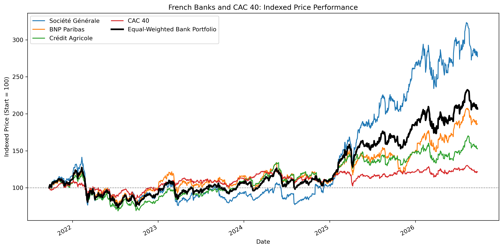
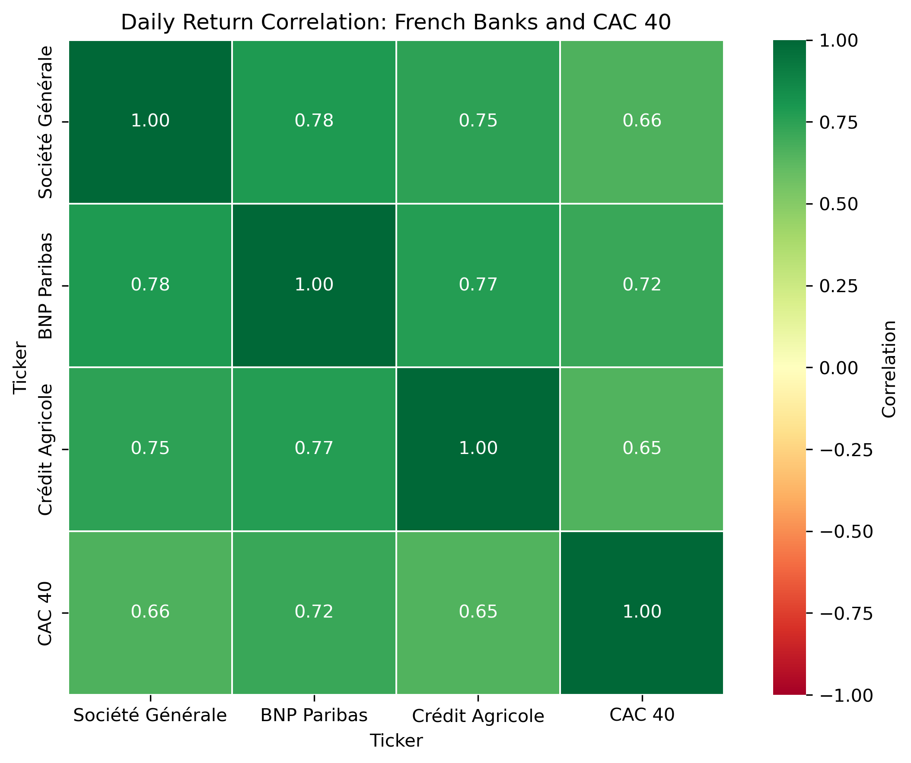
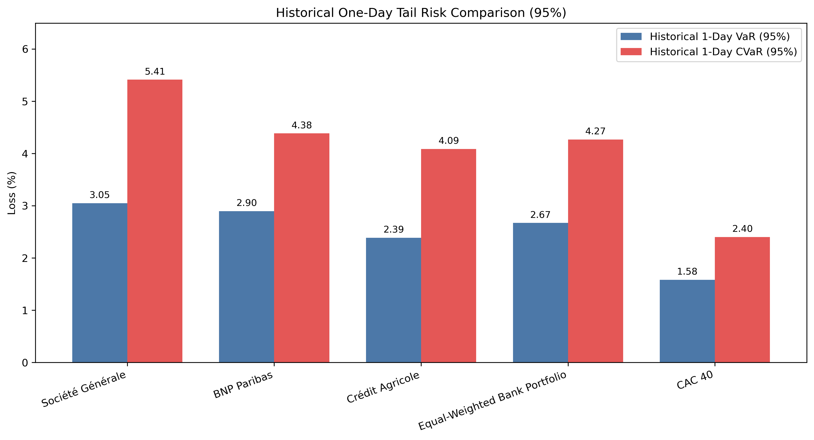
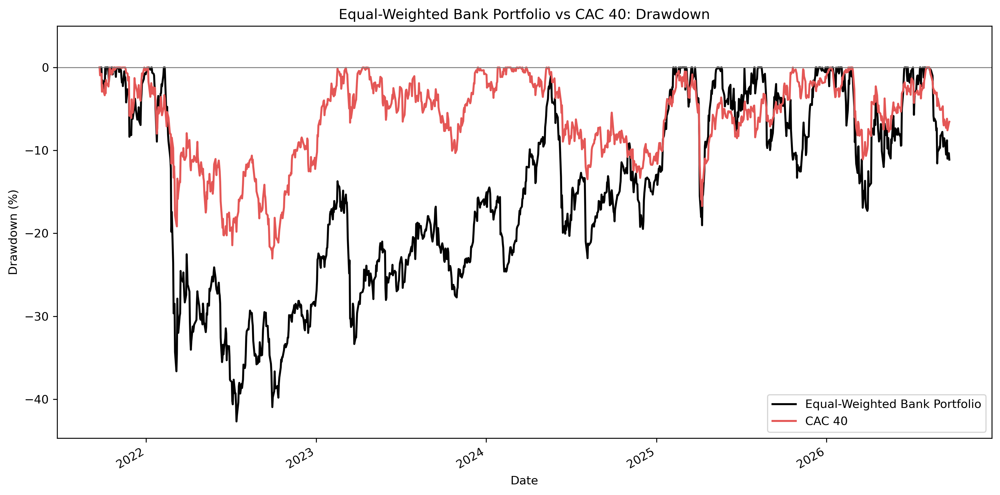
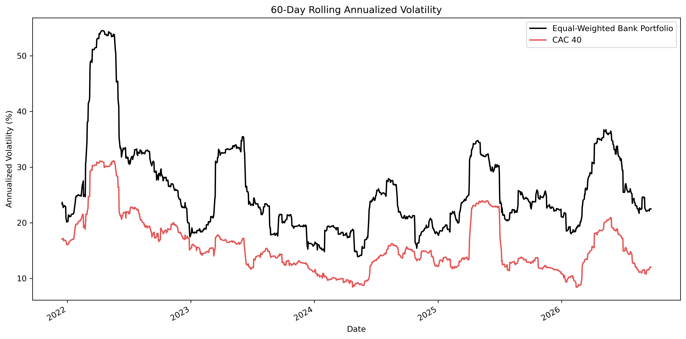

# French Bank Portfolio: Diversification and Market Risk Analysis

## Overview

This project evaluates whether an equal-weighted portfolio of three listed French banks offered improved risk-adjusted price performance relative to its individual holdings and the CAC 40 benchmark.

## Research Question

Does an equal-weighted portfolio of Société Générale, BNP Paribas, and Crédit Agricole improve risk-adjusted price performance relative to its individual constituents and the CAC 40?

## Data

- **Source:** Yahoo Finance, accessed with `yfinance`
- **Frequency:** Daily closing prices
- **Analysis period:** 23 September 2021 to 22 September 2026
- **Aligned observations:** 1,280
- **Assets:** Société Générale (`GLE.PA`), BNP Paribas (`BNP.PA`), Crédit Agricole (`ACA.PA`), and CAC 40 (`^FCHI`)

## Portfolio Construction

The portfolio assigns an equal weight of one-third to each bank and is rebalanced daily.

## Methodology

The analysis calculates total price return, CAGR, annualized volatility, Sharpe ratio with a 0% risk-free rate, maximum drawdown, beta relative to the CAC 40, historical one-day 95% VaR and CVaR, correlations, and 60-day rolling volatility.

## Results

| Asset | Total Price Return | CAGR | Annualized Volatility | Sharpe Ratio | Maximum Drawdown | Beta vs CAC 40 |
|---|---:|---:|---:|---:|---:|---:|
| Société Générale | 177.17% | 22.63% | 34.43% | 0.76 | -47.86% | 1.38 |
| BNP Paribas | 86.35% | 13.27% | 28.42% | 0.57 | -38.61% | 1.25 |
| Crédit Agricole | 52.59% | 8.82% | 24.18% | 0.47 | -42.40% | 0.97 |
| Equal-Weighted Bank Portfolio | 106.64% | 15.63% | 26.70% | 0.67 | -42.69% | 1.20 |
| CAC 40 | 21.68% | 4.01% | 16.32% | 0.32 | -23.04% | 1.00 |

### Historical One-Day Tail Risk (95%)

| Asset | VaR | CVaR |
|---|---:|---:|
| Société Générale | 3.05% | 5.41% |
| BNP Paribas | 2.90% | 4.38% |
| Crédit Agricole | 2.39% | 4.09% |
| Equal-Weighted Bank Portfolio | 2.67% | 4.27% |
| CAC 40 | 1.58% | 2.40% |

## Key Findings

- The equal-weighted bank portfolio outperformed the CAC 40 in total price return and CAGR.
- Portfolio volatility was lower than that of Société Générale and BNP Paribas, but higher than that of Crédit Agricole and the CAC 40.
- The portfolio's Sharpe ratio exceeded those of BNP Paribas, Crédit Agricole, and the CAC 40, but remained below Société Générale's.
- The portfolio's beta of 1.20 indicates above-market sensitivity relative to the CAC 40.
- The portfolio experienced a maximum drawdown of -42.69%, compared with -23.04% for the CAC 40.
- High positive correlations among the three banks limited the downside protection offered by diversification.

## Visualizations

### Indexed Price Performance

### Daily Return Correlation Matrix

### Historical VaR and CVaR Comparison

### Drawdown Comparison

### 60-Day Rolling Volatility

## Reproducibility

Install packages with `pip install -r requirements.txt`, then run `jupyter notebook french-bank-portfolio-risk.ipynb`.

## Limitations

- The analysis uses closing prices, so dividends are not included.
- Daily rebalancing is assumed without transaction costs, taxes, or liquidity constraints.
- The portfolio is concentrated in one sector, so diversification is limited.
- Historical VaR and CVaR describe past behaviour and do not predict future losses.
- This project is for educational purposes only and is not investment advice.

## Skills Demonstrated

- Python and Jupyter Notebook
- Financial data collection with `yfinance`
- Data cleaning and alignment with `pandas`
- Portfolio construction and risk measurement
- Correlation, beta, drawdown, VaR, and CVaR analysis
- Financial data visualization with `matplotlib` and `seaborn`
- Reproducible project organization
